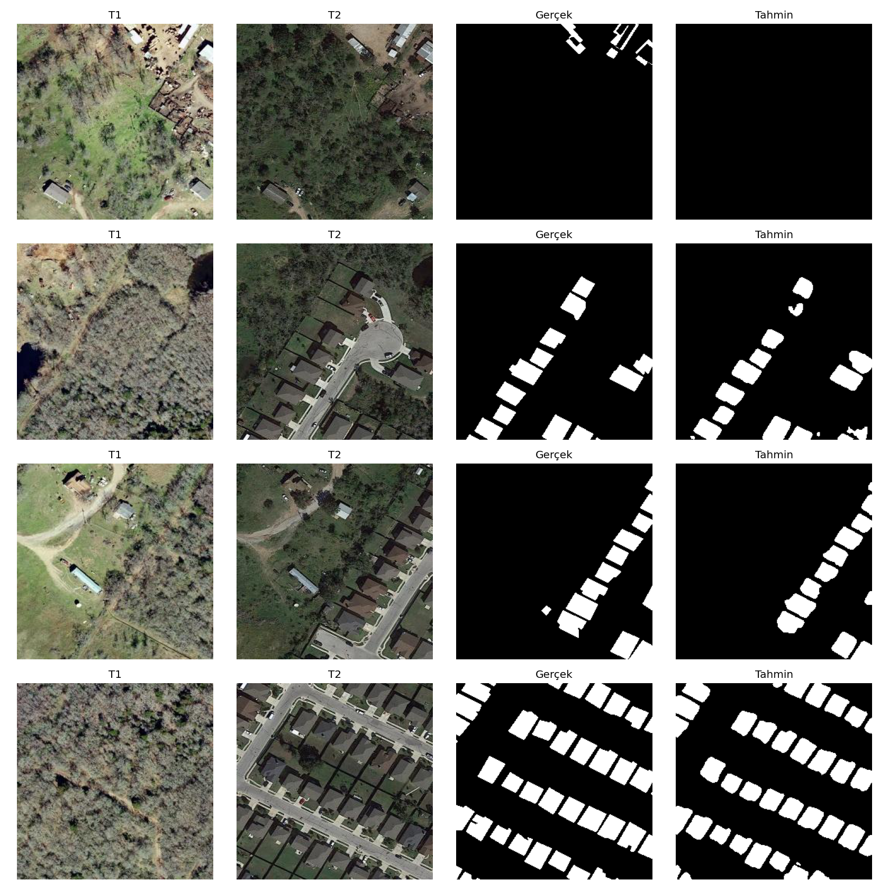
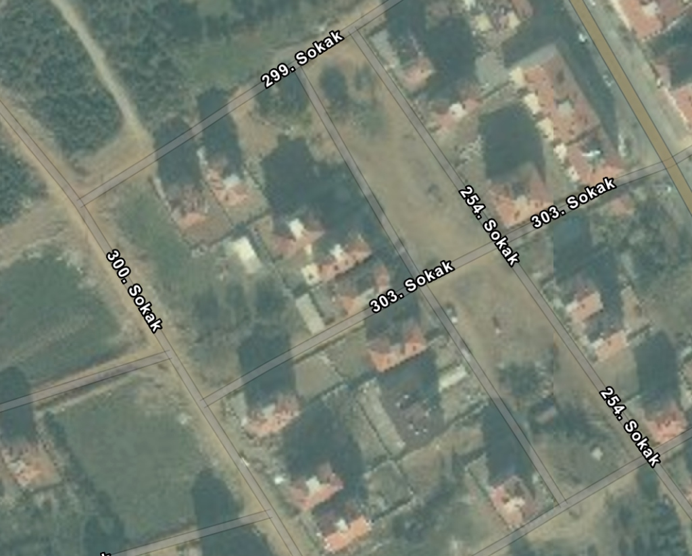
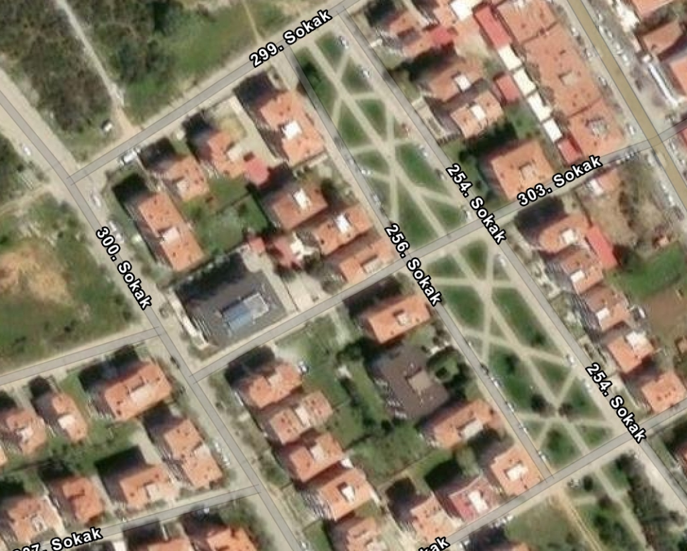
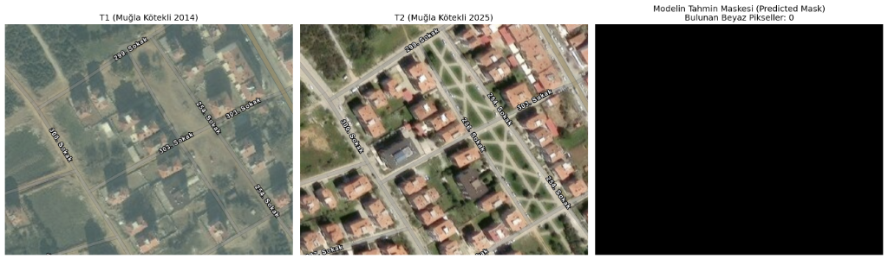
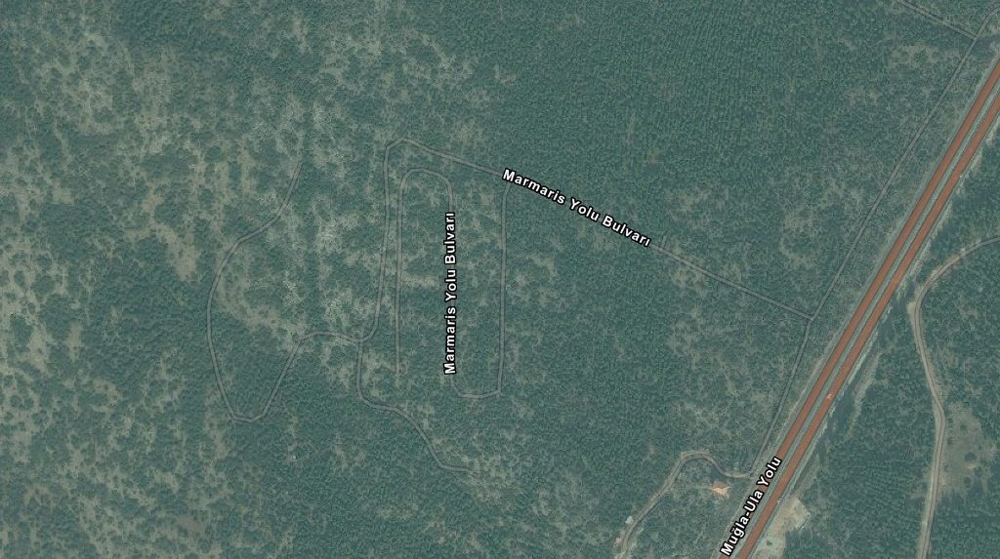
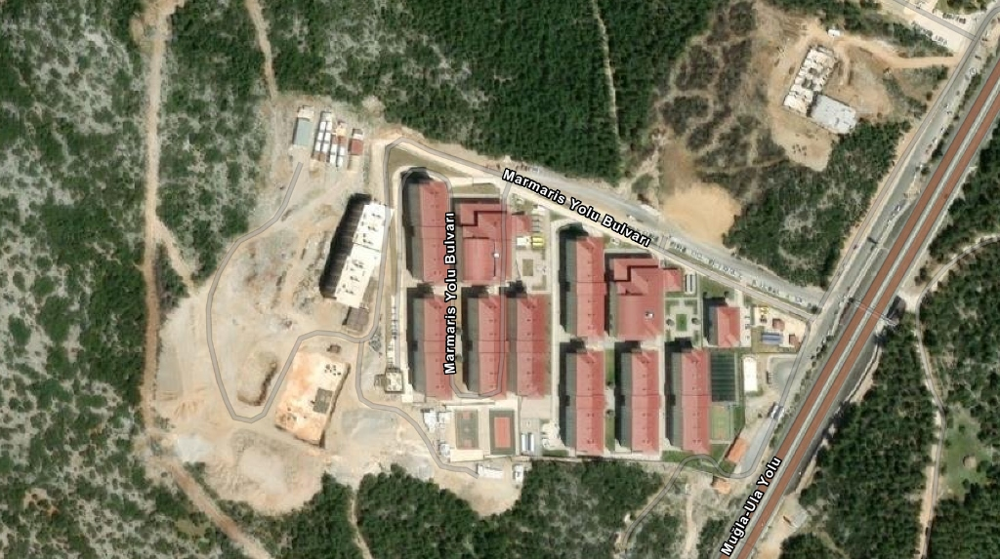
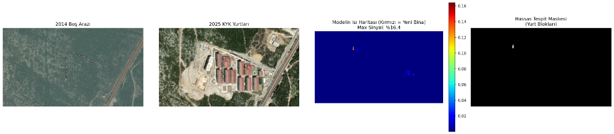

# Bitemporal Uydu Görüntülerinde Kentsel Değişim Tespiti
### Remote Sensing Building Change Detection Pipeline

Bu çalışma; farklı tarihlerde çekilmiş çift-zamanlı (bitemporal: $T_1$ ve $T_2$) yüksek çözünürlüklü optik uydu görüntüleri üzerinden piksel düzeyinde bina inşaatı ve kentsel değişim tespiti ($0$: Değişim Yok, $1$: Değişim Var) gerçekleştiren uçtan uca bir derin öğrenme sistemidir.

---

## 1. Mimari Tasarım ve Karşılaştırmalı Yaklaşım

Proje kapsamında iki farklı mimari yaklaşım geliştirilmiş ve kıyaslanmıştır:

```text
1. Early Fusion (Baseline):
   [T1 (3ch)] + [T2 (3ch)] ──> Concatenation [6ch] ──> ResNet18 U-Net ──> Değişim Maskesi [1ch]

2. Late Fusion & Attention (Siamese U-Net):
   [T1 (3ch)] ──> Shared ResNet34 Encoder ──┐
                                            ├──> Feature Fusion (|f1-f2| & Concat) ──> CBAM Attention ──> Decoder ──> Değişim Maskesi [1ch]
   [T2 (3ch)] ──> Shared ResNet34 Encoder ──┘
```

### Mimari Detaylar:
* **Baseline (Early Fusion U-Net):** Giriş seviyesinde kanal birleştirmesi ($6$ kanal) yapılarak standart ResNet18 omurgalı U-Net modeline beslenir. İki zaman dilimi arasındaki etkileşim ilk evrişim katmanından itibaren başlar.
* **Siamese U-Net (Late Fusion + CBAM):**
  * **Twin Encoder:** Ağırlıkları paylaşımlı (`shared-weights`) ikiz ResNet34 omurgası ile $T_1$ ve $T_2$ bağımsız dallarda işlenir.
  * **Çok Ölçekli Füzyon (Feature Fusion):** Her skip-connection seviyesinde mutlak fark $|f_1 - f_2|$ ve kanal birleşimi $[f_1; f_2; |f_1 - f_2|]$ çıkarılır.
  * **CBAM (Convolutional Block Attention Module):** Mevsimsel radyometrik kaymaları ve gürültüleri bastırmak, doğrudan yapısal bina sınırlarına odaklanmak amacıyla kanal ve uzamsal dikkat mekanizması uygulanır.

---

## 2. Eğitim Parametreleri ve Optimizasyon

* **Sınıf Dengesizliği (Class Imbalance):** Değişen alanlar uydu görüntülerinin yalnızca %3–5'ini oluşturduğundan, standart Cross-Entropy yerine bileşik kayıp fonksiyonu kullanılmıştır:
  $$\mathcal{L}_{Total} = 0.5 \cdot \mathcal{L}_{BCE} + 0.5 \cdot \mathcal{L}_{Dice}$$
* **Öğrenme Oranı Çizelgesi:** `CosineAnnealingLR` ($3 \cdot 10^{-4} \to 10^{-6}$)
* **Optimizasyon:** `AdamW` (Weight decay: $10^{-4}$)
* **Donanım Hızlandırma:** Google Colab T4 GPU üzerinde `torch.amp` (FP16 Mixed Precision)
* **Veri Standardizasyonu:** $1024 \times 1024$ ham LEVIR-CD görüntüleri, örtüşmesiz $256 \times 256$ piksellik yamalara (patch) ayrılarak eğitilmiştir.

---

## 3. Deneysel Sonuçlar (LEVIR-CD Benchmark)

Modelin eğitim ve doğrulama süreçlerinde yer almayan $2.048$ adet bitemporal test karesi ($134$ milyon piksel) üzerindeki başarım metrikleri:

| Model | Omurga (Backbone) | Parametre | IoU (%) | F1-Score (%) | Precision (%) | Recall (%) | Overall Accuracy (%) |
| :--- | :---: | :---: | :---: | :---: | :---: | :---: | :---: |
| **Baseline Early Fusion** | ResNet18 | 14.3M | **79.64%** | **88.66%** | **89.65%** | **87.70%** | **98.86%** |
| **Siamese U-Net + CBAM** | ResNet34 | 24.8M | **81.61%** | **89.88%** | **90.81%** | **88.96%** | **99.12%** |

*Sonuçlar, Siamese U-Net mimarisinin özellikle çatı sınırlarının ayrıştırılmasında ve yanlış pozitiflerin (False Positive) elenmesinde Baseline modele göre **+1.97 puan IoU** ve **+1.22 puan F1-Score** net başarım artışı sağladığını doğrulamaktadır.*

### Test Seti Çıkarımları:


---

## 4. Gerçek Dünya Dayanıklılık Testi ve Hata Analizi (Out-of-Distribution)

Kapalı veri setinde elde edilen %81.61 IoU skorunun sahaya genelleşebilirliğini ölçmek amacıyla, Muğla Kötekli bölgesine ait 2014 ve 2025 yıllarını kapsayan bitemporal uydu görüntüleri üzerinde sıfır-atışlı (zero-shot) dayanıklılık testleri gerçekleştirilmiştir.

### Vaka 1: Kötekli Yerleşim Alanı (Ölçek Uyuşmazlığı)
2014 ve 2025 yılları arasında yeni konut bloklarının inşa edildiği kentsel parsel:

| 2014 ($T_1$) | 2025 ($T_2$) |
| :---: | :---: |
|  |  |



* **Sonuç:** Model bu geniş açılı görüntüde binaları yakalayamamış ve %0 değişim üretmiştir (*False Negative*).
* **Teknik Neden:** Test görseli yaklaşık $1.5 \text{ km} \times 1.5 \text{ km}$'lik geniş bir alanı kapsamaktadır. Görüntü doğrudan $256 \times 256$'ya yeniden boyutlandırıldığında (resize), apartman blokları $10 \times 15$ piksele kadar küçülmüş; modelin $60 \times 60$ piksel ölçeğindeki evrişim filtrelerinin algı alanının (receptive field) altında kalmıştır.

---

### Vaka 2: Kötekli KYK Yurtları İnşaatı (Alan Kayması / Domain Shift)
2014 yılında ormanlık boş arazi olan bölgeye 2025 yılında devasa yurt bloklarının inşa edildiği parsel:

| 2014 ($T_1$ - Ormanlık Arazi) | 2025 ($T_2$ - Yurt Blokları) |
| :---: | :---: |
|  |  |



* **Sonuç:** Model değişimi sezmiş ancak en yüksek güven skoru %16.4 seviyesinde kalarak standart %35 karar eşiğinin altında kalmıştır.
* **Teknik Nedenler:**
  1. **Spektral ve Radyometrik Alan Kayması (Domain Shift):** LEVIR-CD veri seti Amerikan/Çin banliyölerine özgü gri/antrasit shingle çatılarla eğitilmiştir. Türkiye/Akdeniz coğrafyasına özgü kırmızı/terakota kiremit çatılar ve kireçli sarı-beyaz hafriyat toprağı spektral açıdan modelin alışık olduğu dağılımın dışındadır (Out-of-Distribution).
  2. **Isı Haritası Analizi:** Yukarıdaki ısı haritasında (3. panel) görüldüğü üzere model, yurt bloklarının üzerindeki aktivasyonu net bir tepe noktasıyla (%16.4) yakalamış; ancak renk ve doku yabancılığı nedeniyle aktivasyon genliği standart eşiğin altında kalmıştır. Eşik dinamik olarak ayarlandığında (4. panel) yurt bloklarının geometrisi belirginleşmektedir.

---

## 5. Mühendislik ve Araştırma Yol Haritası

Tespit edilen zayıflıkları gidermek ve sistemi coğrafyadan bağımsız dayanıklı bir motora dönüştürmek için uygulanacak adımlar:

### Adım 0: Kayan Pencere (Sliding Window & Gaussian Blending) Çıkarımı
Büyük boyutlu haritalarda yeniden boyutlandırma kaynaklı bilgi kaybını engellemek amacıyla:
* Girdi görüntüleri orijinal çözünürlüğünde korunarak $256 \times 256$ pencerelerle taranır.
* Sınır süreksizliklerini (seam artifacts) engellemek için %50 örtüşme (`stride=128`) ve 2D Gaussian ağırlıklandırma ile harita pürüzsüz birleştirilir (stitching).

### Adım 1: `src/datasets.py` Alan Kayması ve Radyometrik Augmentasyon
Modelin tek bir çatı rengine veya sensör kalitesine bağımlı kalmasını önlemek için veri hattına eklenecek dönüşümler:
* **Kiremit Çatı ve Işık Simülasyonu:** Renk tonu kaydırma (`HueSaturationValue` / `ColorJitter`), parlaklık ve kontrast dalgalanmaları.
* **Sensör ve Sıkıştırma Bozulmaları:** Web haritalarındaki sıkıştırma artefaktlarını modellemek için `ImageCompression` (JPEG kalite düşürme), `GaussianBlur` ve `GaussNoise`.
* **Ölçek Çeşitliliği:** Farklı uçuş yüksekliklerini simüle etmek için `RandomScale` ve `RandomResizedCrop`.

### Adım 2: Çoklu Veri Seti Eğitimi ve Yerel İnce Ayar (Domain Adaptation)
* **Çoklu Coğrafya:** LEVIR-CD'ye ek olarak **WHU-CD** (Yeni Zelanda) ve **SYSU-CD** (Hong Kong) veri setleri hatta entegre edilerek çatı ve doku çeşitliliği artırılacaktır.
* **Yerel Adaptasyon:** Türkiye uydu görüntülerinden derlenecek mini veri paketi ile düşük öğrenme oranıyla ($5 \cdot 10^{-5}$) 15–20 epoch'luk ince ayar (fine-tuning) yapılacaktır.

---

## 6. Proje Yapısı

```text
remote-sensing-change-detection/
├── configs/
│   └── config.yaml              # Model, veri ve hiperparametre ayarları
├── data/
│   ├── raw/                     # Ham uydu görüntüleri (1024x1024)
│   └── processed/               # 256x256 patch veri seti (train/val/test)
├── notebooks/
│   ├── 01_eda.ipynb             # Keşifsel veri analizi
│   ├── 02_error_analysis.ipynb  # Hata analizi
│   └── colab_train.ipynb        # Colab GPU eğitim defteri
├── scripts/
│   ├── download_levir_cd.py     # Veri seti indirme
│   ├── patch_images.py          # 1024x1024 -> 256x256 yamalama
│   └── evaluate_large.py        # Kayan pencere (Sliding Window) çıkarımı
├── src/
│   ├── datasets.py              # Çiftli veri yükleyici ve augmentasyon
│   ├── models/
│   │   ├── baseline_unet.py     # 6-kanallı Early Fusion U-Net
│   │   ├── siamese_unet.py      # İkiz kollu Siamese U-Net
│   │   └── attention.py         # CBAM kanal & uzamsal dikkat blokları
│   ├── losses.py                # BCE, Dice ve Compound kayıp fonksiyonları
│   ├── metrics.py               # IoU, F1, Precision, Recall hesaplayıcıları
│   └── train.py                 # Eğitim ve doğrulama motoru
├── visualizations/              # Test çıkarımları ve hata analizi görselleri
├── app.py                       # Gradio interaktif web demosu
├── requirements.txt
└── README.md
```

---

## 7. Kurulum ve Çalıştırma

### Ortam Kurulumu
```bash
python3 -m venv .venv
source .venv/bin/activate
pip install -r requirements.txt
```

### Model Eğitimi (Yerel / CUDA)
```bash
python src/train.py --config configs/config.yaml
```

### Büyük Görüntülerde Çıkarım (Sliding Window)
```bash
python scripts/evaluate_large.py --t1 <T1_yolu> --t2 <T2_yolu> --checkpoint checkpoints/best_model.pth
```

### İnteraktif Web Arayüzü (Gradio)
```bash
python app.py
```
